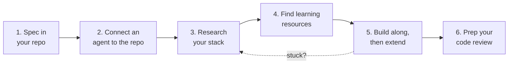

# Learn with Agents: From Your Spec to a Learning Plan

> 🎥 Class recording: [Spec → Repo → Agents (Oct 19)](https://app.read.ai/analytics/meetings/01M5B3WJDTEY5X4VF2D0K87XVW?utm_source=Share_CopyLink)
> Works for every product you build this semester, not just Product 1.

This isn't about "vibe coding," where you ask an AI to build the whole thing and hope. It's about using AI to **figure out what you need to learn, find the best way to learn it, and then build it yourself with help.**

> *"How do I turn my interest into research that I can understand, use AI to get better insight on, and learn as I work on these dope things?"*

Think of your AI agent as a **GPS for learning**. Your **spec** is the destination. The agent helps you plan the route (your stack), find the best roads (tutorials and docs), and reroute when you get stuck. **You're still the one driving.**

---

## The workflow at a glance



**Running example:** Budget Buddy, the personal finance app from class. Swap in your own product as you go.

---

## Step 1: Put your spec in your repo

Your spec is the **context** you give every AI. Without it, the AI guesses. With it, the AI knows exactly who you are, what you're building and why.

- Your repo's `README.md` should be your spec. (Need help? See the [Spec Guide](../projects/product-1/product-spec-guide.md) and the [Git & GitHub Setup Guide](../projects/product-1/git-github-setup.md).)
- **Give your project a real name**, like *Budget Buddy*, not *project-1*. You're building a product.

---

## Step 2: Connect an agent to your repo

A **repo gives the AI a dedicated place to look**. Once it's connected, the agent can read your spec (and later your code) instead of you copying and pasting everything.

Pick the tool you use. 🔑 **Least privilege:** when GitHub asks what to allow, choose **"Only select repositories"** and pick just this repo.

<details open>
<summary><strong>GitHub Copilot</strong>: free for verified students through <a href="https://education.github.com">GitHub Education</a></summary>

**Option A: Copilot Spaces (in your browser, the one we demoed in class)**
1. Go to **[github.com/copilot/spaces](https://github.com/copilot/spaces)** and create a new space (think of it as a project folder for Copilot).
2. Name it after your product, then **add a source** and choose your repository.
3. Start chatting. Copilot now reads your repo, including your spec.

**Option B: the GitHub Copilot desktop app**, which can also make changes on a branch and open pull requests. See [Git & GitHub Setup → Step 12](../projects/product-1/git-github-setup.md#12-connect-an-ai-agent-to-your-repo-stretch--at-home).

**Option C: Codespaces**: on your repo page, click **Code → Codespaces → Create codespace**. You get VS Code in the browser, with Copilot chat built in.
</details>

<details>
<summary><strong>Claude</strong></summary>

**Claude.ai chat (all plans, including Free):** connect GitHub under **Customize → Connectors → GitHub Integration**. Then, in a chat, click **+ → Add from GitHub** and pick your repo (or specific files). Claude can **read** your repo but not change it.

**Claude desktop app, Code tab (paid plans):** open your repo folder (**Local → Select folder**). Claude can read, edit and run your project, and open pull requests. Start in **Plan** or **Manual** mode so you approve every change.
</details>

<details>
<summary><strong>ChatGPT / Codex</strong></summary>

**ChatGPT:** connect GitHub in **Settings** (look for **Apps / Connectors / Plugins → GitHub**) and choose your repo. ChatGPT can read it to answer questions (read-only).

**Codex** (in the ChatGPT desktop app or at [chatgpt.com/codex](https://chatgpt.com/codex)): connect GitHub, pick your repo, and describe a task. It works on a branch and hands you a **pull request** to review. Free-plan access is limited.
</details>

<details>
<summary><strong>Cursor</strong></summary>

Cursor works on a copy of your repo **on your computer**:
1. In your terminal: `gh repo clone your-username/your-repo` (or **File → Open Folder** if you already have it).
2. Open the folder in Cursor and open the chat panel. The agent can see every file in the project.
</details>

<details>
<summary><strong>Gemini</strong>: especially good for finding YouTube videos</summary>

At **[gemini.google.com](https://gemini.google.com)** on a computer: click **+ (Add file) → Import code**, paste your repo URL, then ask your question.
- **Private repo?** You'll be asked to link your GitHub account, or make the repo public.
- The import is a **snapshot**. If you change your repo later, import it again.
- You may need to be signed in with a **personal Google account**. Some school accounts block this.
</details>

> **No repo access in your tool?** Paste your README into the chat. Then ask the AI to give you an updated version as a Markdown file, and commit that to your repo yourself.

**🤖 First prompt (any tool):**
```text
This repo's README is my product spec. Read it, then summarize in 3 sentences
what I'm building, who it's for, and what my MVP is. Then ask me up to 5
questions about anything that's unclear or missing. Don't suggest code yet.
```

---

## Step 3: Research your stack

**Use AI as a research partner, not a builder.** *"You're not asking it to build the thing immediately for you."* You're asking it to help you understand your options.

Two ways to start:
1. **Does an app like yours already exist?** Look up what it's built with.
2. **Is it something new?** Ask the AI for a simple stack that fits your spec. See the [Surfaces guides](../surfaces/README.md) to compare CLI, web, mobile, desktop and chat.

**🤖 Prompt:**
```text
Based on my spec, suggest 2 simple tech stacks I could use to build the MVP
in about 4 weeks as a student. For each: front end, back end, data, hosting,
why it fits my problem, and what I'd need to learn. I know [languages/tools I
know]. Recommend one, and explain the trade-offs in plain language.
```

**🤖 Follow-up: update the spec:**
```text
I'm going with [stack]. Update the Tech Stack section of my README with these
choices, a one-line reason for each, and a Mermaid architecture diagram.
Show me the changes before saving them.
```
*(Read every change it makes. In class, Copilot updated the README correctly, but always check.)*

---

## Step 4: Find learning resources

> *"Sometimes reading from the AI isn't the best way to learn."*

Watching someone build something similar is a great way to learn. Your job is to find **the right** tutorial, so your time is well spent.

**Mix your tools.** Each AI is better at different things. *"Google owns YouTube,"* so **Gemini** is especially good at finding videos. Use your main agent for docs and articles.

**🤖 Prompt: YouTube (try it in Gemini):**
```text
I'm a student building [one-line description] based on the spec in this repo.
My stack is [stack]. Find 5 YouTube tutorials that would help me build the
MVP. Prefer videos from the last 2 years that use the same tools and
versions, are beginner-friendly, and build something similar to my app. For
each: title, channel, link, length, and what part of my MVP it helps with.
```

**🤖 Prompt: docs, blogs and courses:**
```text
For my stack ([stack]) and my MVP features ([list]), find the official docs
page or getting-started tutorial for each tool, plus 2–3 high-quality written
tutorials or free courses. Put them in the order I should learn them, and
explain why each one matters for my project.
```

> ⚠️ **Click every link.** AI sometimes invents links or titles that sound real. If a link doesn't work, or the video uses a very old version of a tool, skip it.

### Is this tutorial worth my time? ✅
- [ ] It builds something **similar** to my MVP (a budget app for a budget app)
- [ ] It uses **my stack** (or close), and was made **recently**
- [ ] It's at **my level**: I can follow the first 5 minutes
- [ ] Its **length fits** my schedule (a 9-hour course isn't a "this week" resource)
- [ ] The comments or likes suggest it **works** and isn't outdated

---

## Step 5: Build along, then extend

> *"Following a video tutorial isn't a bad idea… The video is not going to have everything you want out of it. So you got to use your brain, and maybe some questions to the AI, to figure out: how do I actually augment this to do this specific thing?"*

1. **Follow the tutorial in your own repo.** Type the code yourself, and **commit after each section** (`git commit -m "Add expense form from tutorial part 2"`).
2. **List the gaps.** Compare what the tutorial built with your spec's MVP. What's missing or different?
3. **Close the gaps with AI**, one at a time:

**🤖 Prompt: extend the tutorial:**
```text
I followed [tutorial name/link] and now have [what works]. My spec needs
[specific feature that's different]. Explain what I need to change and why,
step by step. Let me write the code, then review what I wrote and explain any
mistakes.
```

**🤖 Prompt: explain code I don't understand:**
```text
Explain this code line by line like I'm new to [language]. What would break
if I removed [line]? [paste code or name the file]
```

### Keep a learning log (optional, recommended)

Create a **`LEARNING.md`** file in your repo and add to it as you go. It takes 2 minutes a session, and it's your **cheat sheet for the code review**: most review questions are about your process.

```markdown
# What I Learned Building [Product Name]

## Resources I used
| Resource | Link | What it helped with |
|---|---|---|
| | | |

## Log
### [Date]
- **What I didn't know:**
- **How I figured it out** (which AI tool, prompt, video or doc):
- **Where the AI got it wrong** (and how I noticed):
- **What I built / changed:**
```

---

## Step 6: Prep for your code review

Your [Product 1 code review](../projects/product-1/grading.md#part-3-your-code-review-presentation) asks you to pitch, explain your architecture, walk through your code, and talk about your process. Use your agent as a **practice interviewer**.

**🤖 Prompt: mock code review:**
```text
Act as my instructor in a 5-minute code review of this repo. Ask me one
question at a time about: my problem and MVP, why I chose this stack, how
data flows through my app, what a specific file does, and how I used AI
while building. Wait for my answer each time, then tell me what was strong
and what was unclear. Don't answer for me.
```

**🤖 Prompt: find my weak spots:**
```text
Look at my code. Point out the 3 parts a reviewer is most likely to ask about
(complex logic, unusual choices, or AI-generated-looking code). For each,
quiz me until I can explain it in my own words.
```

---

## Ground rules

- 🧠 **You're responsible for every line.** If you can't explain it, ask the AI to teach you before you commit it.
- 🔍 **Verify, don't trust.** Check links, run the code, and read the diff before accepting changes.
- 🔑 **Least privilege.** Connect agents to **only** the repos they need. Never paste passwords or API keys into a chat.
- 🌿 **Let agents work on branches.** Review their pull requests like a teammate's (see [Step 11 of the setup guide](../projects/product-1/git-github-setup.md#11-your-first-pull-request-stretch)).
- 🔀 **Mix your tools.** One AI might be better at code, another at finding videos. Use what works and note which ones in your `LEARNING.md`.
