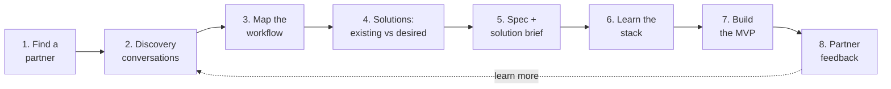

# Product 2: Build for Someone Else

> **Solo or in pairs** · **Check-in: Mon Nov 23** · **Due and presented: Mon Nov 30**
> Product 1 was for **you**. Product 2 is for **a real person who runs something**: a small business, an entrepreneur, a nonprofit or a campus org. It can be family. You'll learn their world, find a problem worth solving, and build a first version that helps them.

In Product 1, you interviewed yourself. Now you **turn that same process outward**. That's what product engineers and tech consultants do every day: they sit with someone who has a problem, understand how their work *actually* happens, and build the smallest thing that makes it better.

> *"All businesses are structured around the solution of problems."* Your job is to find one worth solving.

---

## The journey



| Stage | What you do | Guide | Target date |
|---|---|---|---|
| **1. Find a partner** | Pick a business or person, go **in person**, and ask for 2 short conversations | [🤝 Find a Partner](./find-a-partner.md) | **Wed Nov 11** |
| **2. Discovery** | Conversation #1: learn their business, their day and their pains | [🔍 Discovery Guide](./discovery-guide.md) | **Fri Nov 13** |
| **3. Map the workflow** | Draw how the work happens today, step by step, and mark where it hurts | [🔍 Discovery Guide → Workflow map](./discovery-guide.md#part-3-map-the-workflow) | **Mon Nov 16** |
| **4. Existing vs desired solutions** | What they use now, what they wish existed, and whether an **automation** could help | [⚙️ Automations](./automations.md) | **Mon Nov 16** |
| **5. Spec + solution brief** | Write your spec, plus a one-page brief your partner can read | [📄 Spec Template](./SPEC_TEMPLATE.md) | **Wed Nov 18** |
| **6. Learn the stack** | Choose a surface and stack, and find the right tutorials | [Surfaces](../../surfaces/README.md) · [Learn with Agents](../../modules/learn-with-agents.md) | **Wed Nov 18** |
| **7. Build the MVP** | Build the smallest thing that helps, and show progress at the check-in | [Git & GitHub Setup](../product-1/git-github-setup.md) | **Check-in Mon Nov 23** |
| **8. Partner feedback** | Show your partner the MVP and record what they say | [🔍 Discovery Guide → Feedback](./discovery-guide.md#part-5-the-feedback-conversation) | **By Sun Nov 29** |
| **Present** | Pitch, discovery story, demo, code review and partner feedback | [✅ How Product 2 Is Graded](./grading.md) | **Mon Nov 30** |

> ⏰ **We're starting late, so move fast on Stage 1.** Have a partner confirmed by **Wed Nov 11**. If your first ask doesn't work out, try your second one right away.

---

## What's different from Product 1

| | Product 1 | Product 2 |
|---|---|---|
| **The user** | You | Your partner (and maybe their staff or customers) |
| **How you learn the problem** | Reflecting on your own week | **Talking to them**, ideally in person, and watching how they work |
| **Problem statement** | "When *I*…" | "When *[partner]*…" |
| **Solutions to consider** | Apps you'd use | Apps **and automations**: connecting tools they already use so work happens by itself |
| **Proof** | Your own "solved when" line | Your partner's **feedback** on your MVP |
| **Deliverables** | Spec, repo, presentation | The same, plus **discovery notes**, a **workflow map** and a **one-page solution brief** for your partner |

---

## Working in pairs (optional)

You can work **alone or with one partner**. If you pair up:
- **One business, one repo.** Add your teammate as a collaborator: **Settings → Collaborators → Add people**.
- **Both of you go to the conversations** if you can. One person asks questions, the other takes notes, then switch.
- **Both of you write code.** Work on branches and open pull requests (see [Step 11 of the setup guide](../product-1/git-github-setup.md#11-your-first-pull-request-stretch)). **Your commit history should show both of you.**
- **Both of you present**, and each of you answers code questions about **code you wrote**.
- List who did what in the **Team** section of your README.

---

## 🤖 Starter prompts for each stage

> 🔒 **Protect your partner's privacy.** Don't paste customers' names, phone numbers, addresses, money details or anything your partner asked you to keep private into an AI tool. Describe things in general terms ("a customer's order") instead.

**Stage 1: Prep your ask**
```text
I'm a Lehman College computer science student. For a class project, I need
to help a small business or entrepreneur by learning about their work and
building a small software tool or automation for free. I'm going to visit
[type of business] in person. Help me prepare a friendly 30-second
introduction and 3 likely questions they'll ask me, with short honest
answers. Keep it natural, not salesy.
```

**Stage 2: Prep your first conversation**
```text
I'm meeting the owner of a [type of business] for a 30-minute discovery
conversation. My goal is to understand their day, the tasks that take the
most time, and where things go wrong. I should not pitch solutions. Using the
discovery guide below, help me pick the 8 best questions for this kind of
business, and suggest good follow-up questions.
[paste the question bank from discovery-guide.md]
```

**Stage 2: Debrief after the conversation**
```text
Here are my notes from a discovery conversation with a [type of business]
(personal details removed): [paste notes]. Help me organize them into:
their goals, their daily workflow, pain points (with how often and the
cost), tools they use now, and things they wish existed. Point out what I
should ask about in my next conversation. Don't propose solutions yet.
```

**Stage 3–4: Find automation opportunities**
```text
Here's my partner's workflow map with the pain points marked: [paste]. Which
steps are repetitive, rule-based or copy-paste work that could be automated?
For each, suggest one simple option using tools they already have (like
Google Sheets, Forms, Gmail or Square) and one custom-built option. Rate how
hard each would be for a student to build in about 2 weeks.
```

**Stage 5: Check my problem statement and brief**
```text
Here's my problem statement and one-page solution brief for my partner, a
[type of business]: [paste]. Act as the business owner reading it. Is it
clear, in plain language, with no tech jargon? Does it describe their
problem the way they would? What would they push back on? Don't rewrite it.
Ask me questions.
```

**Stage 6–7: Stack, tutorials and building.** Use the prompts in [Learn with Agents](../../modules/learn-with-agents.md) and the [Surfaces guides](../../surfaces/README.md).

---

## Files in this folder
- [🤝 Find a Partner](./find-a-partner.md): who to ask, places around Lehman, and outreach scripts and templates
- [🔍 Discovery Guide](./discovery-guide.md): conversation scripts, workflow mapping, existing vs desired solutions, and the feedback conversation
- [⚙️ Automations & Workflow Improvements](./automations.md): automations as real solutions, with examples and starter stacks
- [📄 Spec Template](./SPEC_TEMPLATE.md): your Product 2 README, including the discovery log and solution brief
- [✅ How Product 2 Is Graded](./grading.md)
