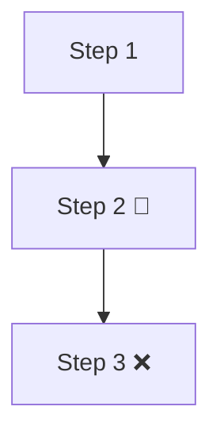
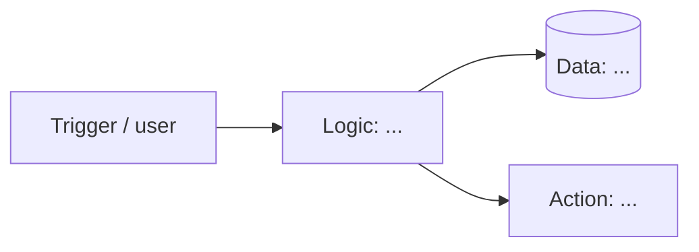

<!--
  Product 2 Spec Template
  Copy everything in this file into the README.md of your Product 2 repository.
  Walkthrough, examples, and AI prompts: https://github.com/464squad/IEL/tree/main/projects/product-2
  Delete these instructions and the italic hints as you fill each section in.
  Privacy: no customer names, contact info, prices/revenue, or anything your partner asked to keep private.
-->

# [Product Name]

> One line: what this is, and who it helps.

**Partner:** [Business name, or a nickname like "a Bronx barbershop"] · **Partner's role:** [owner / manager]
**Team:** [Your name(s)] · **Course:** CMP 464/343 Product 2 · **Last updated:** [date]
**Live demo:** [deployment URL, video link, or "see Demo section"]

---

## 1. About the Partner

*What do they do, who are their customers, and what are they trying to grow or improve?*

[Your answer]

---

## 2. Discovery Log

*One entry per conversation. Use the notes template from the Discovery Guide.*

### Conversation #1 · [date] · [in person / phone] · with [role]
- **Their goals:**
- **How the work happens today:**
- **Pain points** (how often · what it costs):
- **Tools they use now:**
- **What they've tried / wish existed:**
- **Best quote:** "..."

### Conversation #2 · [date] · …

---

## 3. Workflow Map (today)

*Show how the work happens now, step by step. Mark 🔴 slow · 🔁 repetitive · ❌ error-prone · 🕳️ falls through the cracks. Use a Mermaid diagram or a photo.*

---

## 4. Problem Statement

> **When** [a specific moment that keeps happening],
> **[partner] struggles to** [what goes wrong],
> **which costs them** [time / money / stress, with numbers from discovery].
> **This happens because** [root cause].
> **Right now they** [current workaround], **but** [why it falls short].

**They'll know this is solved when:** [something your partner could observe changing]

*Check: written about your partner, not you. Facts come from your discovery notes. No solution words (app, website, platform, dashboard, AI, automate…).*

---

## 5. Existing vs Desired Solutions

| Area | Today (existing) | Desired | Gap |
|---|---|---|---|
| | | | |
| | | | |

**Solution type:** [use an existing tool better / automation / custom app / a mix]. *Why does this fit your partner?*

---

## 6. Features & Benefits

| Feature (what it does) | Benefit for the partner | MVP or Later? |
|---|---|---|
| | | |
| | | |
| | | |

**MVP (2–3 features):**
-

**Later:**
-

**Not doing:**
-

---

## 7. Tech Stack & Architecture

### Surface
- **Surface:** [Web / Mobile / Desktop / CLI / Chat / Automation (+ simple interface)]
- **Why:** *Where and how will your partner (or their customers) use it?*

### Stack
| Piece | Choice | Why |
|---|---|---|
| Front end / interface | | |
| Back end / automation logic | | |
| Data | | |
| Outside services / APIs | | |
| Hosting / where it runs | | |

### Architecture
*Show how a trigger or request flows through the system.*

---

## 8. Solution Brief (for your partner)

*One page, written in **plain language**: no tech jargon. You should be able to hand this to your partner.*

**The problem we heard:** [1–2 sentences, in their words]

**What we're building:** [1–2 sentences]

**How it will help:** [time saved, money saved, fewer mistakes]

**What you'll need to do:** [e.g. "fill out a form when a customer books" / "nothing, it runs automatically"]

**What it won't do (yet):** [scope limits]

---

## 9. Demo

*Screenshots, a GIF, a video (under 2 min), or a live link. For automations, show the whole flow from trigger to result.*

---

## 10. Partner Feedback

**Date and format:** [in person / video call]

- "Quote 1"
- "Quote 2"

**What worked:**
**What didn't / was confusing:**
**What they'd want next:**

---

## 11. Team *(pairs only)*

| Teammate | What I did (discovery, features, files) |
|---|---|
| | |

---

## 12. What We Learned

*What you didn't know at first, how you figured it out (which tools, tutorials and AI), where the AI got it wrong, and what you'd do differently.*
