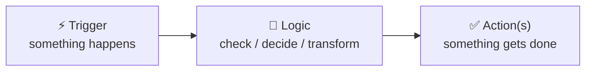
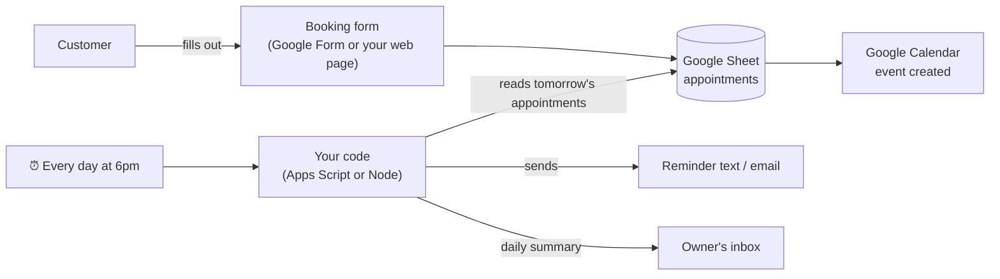

# ⚙️ Automations & Workflow Improvements

> Part of [Product 2](./README.md) · Also see [Surfaces](../../surfaces/README.md)

When you think "software," you probably picture an **app**. But for many small businesses, the most valuable thing you can build is an **automation**: something that makes the boring, repetitive steps **happen by themselves**, using tools they already have.

> On Sep 9 we looked at **Zapier**: a Gmail attachment lands, it's copied to Dropbox, and a Slack alert goes out, all with no one touching it. Those are **API bridges**: APIs connecting one app to another. That's what automation is.

---

## What is an automation?

Every automation has the same shape: **When this happens → do that.**



| Part | Question | Example |
|---|---|---|
| **Trigger** | What starts it? | A new Google Form response · a new email · 9am every day · a new Square sale |
| **Logic** | What should be checked or changed? | "Is the appointment tomorrow?" · "Is stock below 5?" · AI summarizes the message |
| **Action** | What gets done? | Send a text · add a row to a Sheet · email the owner · create a calendar event |

> 🏭 Think of it like a **conveyor belt in a factory**. Instead of a person carrying each box from station to station, the belt moves it automatically. The person only steps in when something needs a human decision.

### Why automations make great Product 2 solutions
- ✅ **They save real time** on work that happens every day or every week, and that's easy to measure ("saves about 2 hours a week").
- ✅ **They use tools the business already trusts**, so there's no new app for them to learn.
- ✅ **They're buildable in 2 weeks**, especially when you start small.
- ✅ **They're real engineering**: triggers, APIs, data and error handling. Just like an app, you'll be able to explain the architecture in your code review.

---

## Spotting automation opportunities

Go back to your [workflow map](./discovery-guide.md#part-3-map-the-workflow). Look for steps marked:

| Signal | Sounds like… | Possible automation |
|---|---|---|
| 🔁 **Copy-paste work** | "I copy each order from DMs into my notebook" | Order form → Google Sheet, automatically |
| ⏰ **Remembering to do something** | "I'm supposed to text people the day before but I forget" | Scheduled reminder texts or emails |
| 📬 **Chasing information** | "I keep asking clients to send their documents" | Form + automatic follow-ups until it's done |
| 📊 **Counting or tallying** | "Every Sunday I count what we used this week" | Weekly summary built automatically from sales data |
| 🗂️ **Sorting or routing** | "I read every email to figure out who should handle it" | AI sorts messages and forwards them to the right person |

---

## Example automations by business type

| Business | Workflow pain | Automation idea |
|---|---|---|
| 💈 Barbershop | No-shows | Booking form → Google Calendar → reminder text the day before |
| 🍳 Food truck / bakery | Catering orders lost in texts | Order form → Sheet → owner gets a daily prep list at 7am |
| 🛠️ Phone repair | "Is my phone ready?" calls | Status updated in a Sheet → customer gets an automatic text when it's "Ready" |
| 📚 Tutoring center | Tracking attendance and payments | Check-in form → attendance Sheet → weekly email to parents with an unpaid balance |
| 🧾 Tax prep | Collecting client documents | Upload form → files sorted into client folders → reminder emails until everything's received |
| ⛪ Community org | Volunteer sign-ups | Sign-up form → confirmation email → reminder 24 hours before → attendance list |
| 🎨 Etsy seller | Low stock surprises | Daily check of inventory → alert when an item is below 3 |

---

## Ways to build automations (beginner → stretch)

| Level | Tool | What it is | Good for |
|---|---|---|---|
| **No-code** | **Zapier**, **Make**, **IFTTT** | Connect apps by clicking: pick a trigger, pick actions | Fast prototypes. Free tiers are limited. |
| **Google-powered** ⭐ | **Google Forms + Sheets + Apps Script** | Free JavaScript that runs inside Google Sheets, Forms and Gmail, with timed triggers | Businesses that already use Google. Free, and it's real code. |
| **Open-source** | **n8n** | A visual workflow builder you can host yourself, with code steps when you need them | More control, and no per-task fees |
| **Custom code** | **Node.js or Python** script + a scheduler, or a **Next.js API route** that receives **webhooks** | Your own code that calls APIs (Twilio for texts, Gmail, Square, Google Sheets) | The most flexible. Best for showing off your code. |
| **AI-powered** | Any of the above + an **LLM API** | Add an AI step: summarize, sort, extract details from messages, draft replies | Messy text: DMs, emails, reviews. See [💬 Chat & LLM](../../surfaces/chat-llm.md). |

> 💡 **For grading, there must be code you wrote and can explain.** A Zap built by clicking alone isn't enough. A strong pattern is **no-code or Google tools for the plumbing + your own code for the core logic** (an Apps Script function, an API route, or a small app with a simple interface for the owner).

### Example architecture: barbershop reminders



**Follow one action:** a customer books for Saturday at 2pm
1. **Trigger:** a new form response.
2. **Data:** a row is added to the appointments Sheet, and a calendar event is created.
3. **Friday at 6pm:** your scheduled code reads Saturday's rows.
4. **Action:** it sends each customer a reminder, and emails the owner tomorrow's schedule.

---

## Build automations responsibly

- 🔑 **Use the business's accounts carefully.** Get permission, create a **separate test copy** (a test Sheet, a test email) first, and never store their passwords in your code. Use the official login or API keys saved in **environment variables**.
- 🧪 **Test with fake data** before anything touches real customers. An automation that texts 200 people by mistake is worse than no automation.
- 👀 **Keep a human in the loop** for anything important. Have the AI *draft* replies for the owner to approve rather than sending them automatically.
- 📜 **Log what it did** (a "log" tab in the Sheet), so the owner can see what happened and you can debug it.
- 🛑 **Make it easy to turn off**, and show the owner how.
- 💸 **Watch costs.** Texting services and AI APIs charge per use. Stay on free tiers, and set limits.

---

## How to demo an automation

Automations happen "behind the scenes," so make them **visible**:
- 🎬 **Screen-record the whole flow**: submit the form → show the Sheet update → show the reminder arriving on your phone.
- 📊 Show the **log** of what ran.
- 🗣️ Tell the **before and after** story: "Before: 15 minutes a day copying DMs into a notebook. After: 0 minutes."

---

## 🤖 Prompts

**Explain it:**
```text
Explain what workflow automation is, using triggers, logic and actions,
with 3 small-business examples. Then explain how tools like Zapier work
under the hood using APIs and webhooks, in plain language.
```

**Find opportunities in my partner's workflow:**
```text
Here's my partner's workflow map and pain points: [paste]. Identify the 3
best automation opportunities. For each: the trigger, logic and actions, the
tools it would connect, the time it would save, and how hard it is for a
student to build in about 2 weeks. Then recommend one, explaining why.
```

**Plan the build (I write the code):**
```text
I'm building this automation for my partner: [trigger → logic → action]. I
want to use [Google Apps Script / Node.js / n8n + my own code]. Walk me
through building it step by step, starting with a test version that uses
fake data. Explain each part. Let me write the code, and review it with me.
Include how to keep any API keys safe.
```

## Learn more
- [Google Apps Script: overview](https://developers.google.com/apps-script/overview) · [Fundamentals of Apps Script with Google Sheets (codelab)](https://developers.google.com/codelabs/apps-script-fundamentals-1)
- [Zapier basics: from A to Zap](https://learn.zapier.com/path/zapier-basics-from-a-to-zap) · [Make Academy](https://academy.make.com) · [n8n docs](https://docs.n8n.io)
- Class: [Full-Stack Architecture & APIs (Sep 9)](https://app.read.ai/analytics/meetings/01M243JXD2A0R750CJ6DMCN2QP?utm_source=Share_CopyLink), which covers APIs, Zapier "API bridges" and MCP
