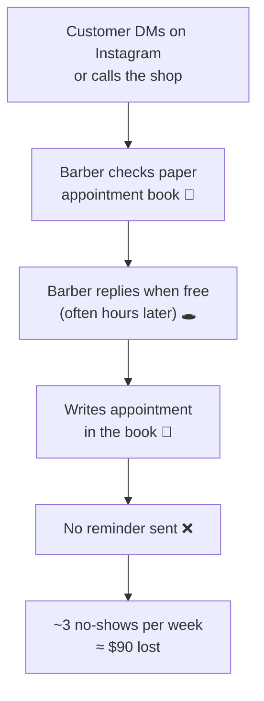

# 🔍 Discovery Guide

> Part of [Product 2](./README.md) · Conversation #1 by **Fri Nov 13** · Feedback conversation by **Sun Nov 29**

**Discovery** is how you learn someone else's world well enough to help them. It's the skill that separates people who *code what they're told* from people who *build what's needed*. In sales and product management, discovery is the job.

In Product 1 you interviewed **yourself**. Now you're doing the same thing with **someone else**, which is harder because you can't read their mind. You have to **ask good questions, listen more than you talk, and watch how the work actually happens.**

> 🩺 **Think like a doctor, not a salesperson.** A good doctor asks about your symptoms, when they started and how bad they are *before* writing a prescription. If you show up pitching an app, you're prescribing before diagnosing.

---

## Part 1: Before the conversation

- [ ] **Learn what you can first**: their website, Instagram, Google reviews and hours. Reviews often reveal pain points ("waited 40 minutes," "never called me back").
- [ ] **Pick 8–10 questions** from the question bank below.
- [ ] **Decide roles** (if pairing): one person asks, one takes notes.
- [ ] **Bring a notebook or notes app.** Typing on a laptop can feel like a formal interview.
- [ ] **Ask before recording.** *"Is it OK if I record audio so I don't miss anything? It's just for my notes."* If they say no, take notes by hand.

---

## Part 2: The discovery conversation (about 30 min)

### Flow
| Time | Part | Goal |
|---|---|---|
| 2 min | **Warm up** | Thank them, restate why you're here, and set expectations ("I'm here to learn, not sell") |
| 8 min | **Their world** | The business, their role, their goals |
| 12 min | **Their day and their pains** | How the work happens, and where it breaks |
| 5 min | **Tools and wishes** | What they use now, what they've tried, what they wish existed |
| 3 min | **Wrap up** | Summarize what you heard, ask what you missed, schedule next steps |

### 📋 Question bank

**Their world**
- How did you start this business? What's your role day to day?
- Who are your customers? What do they come to you for?
- What does a great week look like for the business? What are you trying to grow or improve this year?

**Their day: walk through the work**
- Walk me through yesterday, from opening to closing. What did you actually do?
- What do you do **every day** or **every week**, the same way every time?
- When a customer **[orders / books / drops off / signs up]**, what happens next, step by step? Who does each step?

**Their pains**
- What part of running this takes **more time than it should**?
- What's the most **annoying** or **repetitive** task you do?
- When do things **go wrong**? Tell me about the last time. *(Then ask "why?" a few times: the **Five Whys**.)*
- What do you **forget**, or what falls through the cracks?
- Where do you **lose money**: no-shows, wasted inventory, missed follow-ups?
- If you had **one extra hour a day**, what would you stop doing?

**Their tools and wishes (existing vs desired)**
- What do you use to run things today? (Paper, Google Sheets, WhatsApp, Square, Instagram DMs, a booking app?)
- What have you **tried** that didn't stick? Why not?
- If you had a magic button, what would it do?

**Wrap up**
- Here's what I heard: **[summarize the top 2–3 pains]**. Did I get that right? What did I miss?
- Is there anyone else I should talk to (an employee, a family member who helps)?
- Could I come back **[date]** to show you an idea, or sit in for 15 minutes while the work happens?

### Conversation tips
- **Ask about the past, not the future.** "Tell me about the last time…" beats "Would you use an app that…?" People are polite about hypothetical apps. Past stories are true.
- **Get numbers.** "How often?" "How long does that take?" "How many customers a week?" Numbers turn a complaint into a problem statement.
- **Stay quiet after you ask.** Count to 3 in your head. The good stuff comes after the pause.
- **Don't pitch.** If you get excited about an idea, write it in the margin and keep listening.
- **Watch if you can.** Seeing the work (the paper order pad, the 47 unread texts) teaches you more than hearing about it.

### 📝 Notes template
Copy this for each conversation. It goes in your repo's **Discovery Log** (see the [Spec Template](./SPEC_TEMPLATE.md)).

```markdown
### Conversation #[1] · [date] · [in person / phone] · with [role, e.g. "owner"]

**Their goals:**
-

**How the work happens today** (in their words):
-

**Pain points** (how often · what it costs):
- [pain]: [frequency] · [time / money / stress]

**Tools they use now:**
-

**What they've tried / wish existed:**
-

**Best quote:** "..."

**Questions for next time:**
-
```

> 🔒 **Privacy in your repo:** describe customers in general terms ("a regular customer"), never by name. Don't record prices, revenue or anything your partner asks to keep private. Use a nickname for the business if they prefer.

---

## Part 3: Map the workflow

A **workflow map** draws how one piece of work happens today, **step by step, as it really is** (not how it should be). Then you mark the steps that hurt.

> 🚗 It's like a **delivery route**. Before you can make the route faster, you have to draw the route the driver actually takes, including the wrong turns.

### How to make one
1. **Pick one workflow** connected to the biggest pain, for example "a customer books a haircut" or "restocking supplies."
2. **List every step** in order. Who does it? What tool do they use (paper, phone, Sheets)?
3. **Mark the pain**: 🔴 slow, 🔁 repetitive or copy-paste, ❌ error-prone, 🕳️ things fall through the cracks.
4. **Add numbers** where you can: how long each step takes, and how often.

### Example: a barbershop's appointment workflow (today)



Draw yours on paper and take a photo, or ask an AI to turn your step list into Mermaid like the example above.

**🤖 Prompt:**
```text
Turn this list of workflow steps into a Mermaid flowchart. Mark painful
steps with 🔴 (slow), 🔁 (repetitive), ❌ (error-prone) or 🕳️ (falls
through the cracks) based on my notes: [paste steps + notes]
```

---

## Part 4: Existing vs desired solutions

Now compare **what they use today** with **what they wish existed**, and think about **what kind of solution** fits.

| | Today (existing) | Desired (what they want) | Gap |
|---|---|---|---|
| Booking | Instagram DMs + paper book | Customers book themselves | Replies are slow and the book is messy |
| Reminders | None | Automatic text the day before | No-shows cost about $90 a week |

### Three kinds of solutions to consider
1. **Use an existing tool better.** Sometimes the honest answer is "Square already does this; let me set it up." That's still a win, but for this project, pair it with something you build.
2. **Automate the workflow.** Connect the tools they already use so the repetitive steps happen by themselves. See [⚙️ Automations](./automations.md).
3. **Build a custom app.** When nothing fits how they work. Pick a surface from the [Surfaces guides](../../surfaces/README.md).

> 💡 Many of the best Product 2 solutions are **small automations plus a simple interface**, not a giant app.

---

## Part 5: The feedback conversation

Before **Sun Nov 29**, show your partner your MVP and **write down their reaction**. This is required for grading.

### How to run it (15–20 min)
1. **Remind them of the problem** in their words: *"Last time you said no-shows cost you about $90 a week…"*
2. **Let them use it**, or show it on your phone or laptop. Don't explain every button. Watch where they get confused.
3. **Ask:**
   - "Would this help with what we talked about? Why or why not?"
   - "What's confusing or missing?"
   - "If you had this tomorrow, would you use it? What would stop you?"
   - "What should I build next?"
4. **Thank them**, and ask if you can quote their feedback in your class presentation.

### Capture it
In your README's **Partner Feedback** section, add:
- The date and format (in person, video call)
- **Direct quotes**: at least 2
- What worked, what didn't, and what they'd want next
- *(Optional, strong evidence)* a short written note from them, or an audio or video clip, **with their permission**

---

## 🤖 Prompts for discovery

**Practice the conversation:**
```text
Role-play as the owner of a busy [type of business] in the Bronx. You're
friendly but short on time. I'm a student doing a discovery conversation.
Answer my questions realistically, including small details and some
frustrations. After 8 questions, step out of character and tell me which of
my questions were strong, which were leading or about the future instead of
the past, and what I should have asked.
```

**Find the real problem (Five Whys):**
```text
My partner said: "[quote a pain point]". Help me think through possible
root causes using the Five Whys, and give me 3 follow-up questions I could
ask them to find out which root cause is real. Don't assume. I'll ask them.
```

**Write the problem statement from my notes:**
```text
Based on these discovery notes (personal details removed): [paste]. Help me
draft a problem statement in this format, written about my partner, not me:
"When [moment], [partner] struggles to [what goes wrong], which costs them
[time/money/stress, with numbers]. This happens because [root cause]. Right
now they [current workaround], but [why it falls short]." Use only facts
from my notes. Flag anything I'm guessing at.
```

**Next:** [⚙️ Automations & Workflow Improvements](./automations.md) · [📄 Spec Template](./SPEC_TEMPLATE.md)
