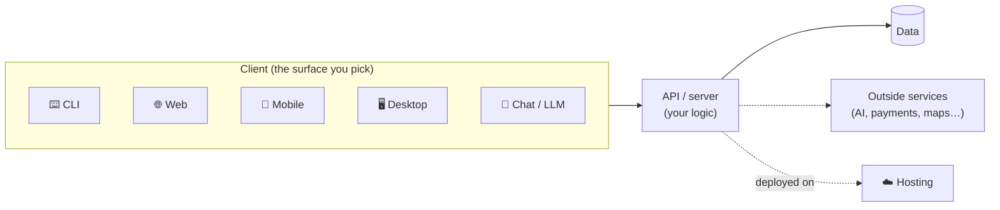

# Surfaces: Same Architecture, Different Client

A **surface** is *where* someone uses your product: a terminal, a browser, a phone, a desktop app, or a chat with an AI. Each one is a different **client**.

Here's the big idea from class: **the client changes, but the rest of the architecture barely does.**

> *"We call the computer that makes requests clients. We call the computers that receive and respond to requests servers… If you want to make a lot of money in tech right now, you need to understand this."*

Think of it like a **restaurant**:
- The **client** is the **menu and the waiter**: how you place your order. A paper menu, an app, a phone call and a drive-through are all different surfaces.
- The **API/server** is the **kitchen**: it does the work, no matter how the order came in.
- The **data** is the **pantry**: where ingredients are stored between orders.
- **Hosting** is the **building**: where the kitchen actually lives so customers can reach it.

You can add a drive-through (a new surface) without rebuilding the kitchen.

---

## Pick your surface

Start with your spec: **where are you, and what device are you holding, when your problem happens?**

| If your problem happens… | Consider | Guide |
|---|---|---|
| At your computer, and you want the fastest first version | **CLI** (command line) | [⌨️ CLI](./cli.md) |
| Anywhere with a browser, on a laptop or a phone | **Web** | [🌐 Web](./web.md) |
| On the go: you need your phone, notifications, the camera or your location | **Mobile & cross-platform** | [📱 Mobile & Cross-platform](./mobile-cross-platform.md) |
| At your computer, and you want a real app window that works offline or uses your files | **Desktop** | [🖥️ Desktop](./desktop.md) |
| When the most natural way to use it is just asking or typing | **Chat / LLM** | [💬 Chat & LLM](./chat-llm.md) |

> 💡 **You can start on one surface and move later.** A CLI that works is a great skateboard. When the logic works, you can put a web or mobile front end on the *same* kitchen.

---

## How every guide is organized

Each surface guide has the same parts, so you can compare them:
1. **What it is**, in plain words
2. **When to choose it**
3. **Architecture**: a diagram, plus one action followed step by step
4. **Beginner-friendly stacks**: simplest, common, and stretch options
5. **Words to use with your AI agent**: the vocabulary that gets you better results
6. **How to demo it**: screenshots, video, or a live link (needed for [Product 1 grading](../projects/product-1/grading.md))
7. **Prompts** to explain, plan and debug
8. **Learn more**: tutorials and the class recordings

## Class recordings on surfaces
- [Full-Stack Architecture & APIs (Sep 9)](https://app.read.ai/analytics/meetings/01M243JXD2A0R750CJ6DMCN2QP?utm_source=Share_CopyLink): clients and servers, the Instagram request flow, APIs, and MCP
- [Web Application Foundations (Oct 5)](https://app.read.ai/analytics/meetings/01M471XZK43DDGWS9ATCT0RFS6?utm_source=Share_CopyLink): URLs, DevTools, HTML/CSS/JS, React, servers, and Next.js
