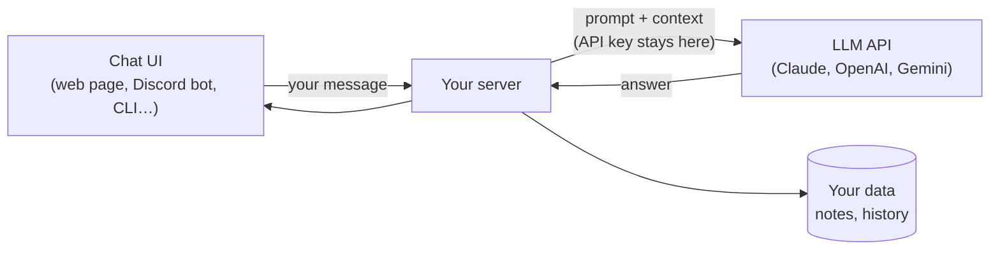
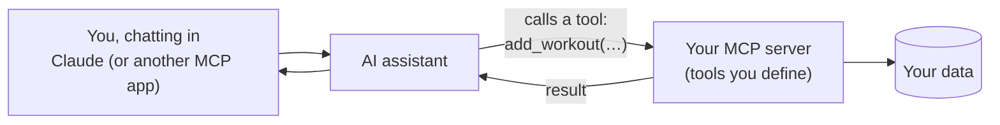

# 💬 Chat & LLM: Conversation as Your Client

> Part of [Surfaces](./README.md): *same architecture, different client.*

## What it is

A **chat surface** is where people use a product by **talking or typing in plain language**, and an **LLM** (large language model, like Claude, GPT or Gemini) figures out what they mean.

On Sep 9 we saw that **ChatGPT is the same client-server pattern as Instagram**: your message is a request, the AI company's servers do the work (running the model), and a response comes back. The new idea is that **AI assistants are becoming a client themselves**: instead of opening five websites, you ask one assistant, and it uses **tools** to go do things for you.

There are two ways you can build on this surface:

| Build… | What it means | Example |
|---|---|---|
| **A) A chat app powered by an LLM** | *Your* product has a chat box, and *your* server sends messages to an LLM API | "Ask my study notes": a chatbot that answers questions from your class notes |
| **B) A tool for an existing assistant (MCP)** | You build a small **MCP server** so Claude (or another assistant) can use *your* data or actions | Let Claude read and add to your workout log when you ask it to |

**MCP (Model Context Protocol)** is a standard plug, like **USB for AI**. If your tool speaks MCP, any assistant that supports MCP can plug into it. The Gmail, Google Drive and GitHub "connectors" you've seen in AI apps are MCP-style tools.

## When to choose it

- ✅ The most natural way to use your product is **asking a question or giving an instruction**.
- ✅ Your problem involves **messy text**: summarizing, searching notes, drafting, explaining (like "simplify these game patch notes").
- ✅ You already live in an AI assistant all day and want it to **work with your own data**.
- ❌ Skip it when a simple button or form is faster and more reliable. Not everything needs AI.

## Architecture

### A) Your own chat app



**Follow one action:** you ask, *"What changed for my main character in today's patch?"*
1. **Chat UI:** sends your question to *your* server.
2. **Your server:** looks up today's patch notes in your data and builds a **prompt**: instructions + the patch notes + your question.
3. **LLM API:** the model reads it and writes an answer.
4. **Your server → you:** shows the answer, and saves the conversation if you want history.

> 🔒 **Your API key must stay on the server**, never in front-end code or your repo. Anyone who finds it can spend your money. Put it in a `.env` file that's listed in `.gitignore`.

### B) An MCP tool for an existing assistant



**Follow one action:** you tell Claude, *"Log bench press 135 × 8."*
1. The assistant sees that your MCP server has a tool called `add_workout`.
2. It calls that tool with `exercise: "bench press", weight: 135, reps: 8`.
3. Your MCP server saves it and replies "Saved."
4. The assistant tells you it's logged. **You built the tool. The assistant is your client.**

## Beginner-friendly stacks

| Level | Client | Server | AI | Data |
|---|---|---|---|---|
| **Simplest** | [CLI](./cli.md) chat loop | Same script | An LLM provider's API (official SDK for Python or TypeScript) | Text/JSON files |
| **Common** ⭐ | **Next.js** chat page | Next.js API route | LLM API (e.g. Claude) + the **Vercel AI SDK** for streaming | Supabase |
| **Bot** | **Discord** or **Telegram** bot | Node or Python bot | LLM API | SQLite |
| **MCP** | Claude Desktop, or another MCP-capable app | An **MCP server** using the official TypeScript or Python SDK | The assistant you already use | Your data |

> 💰 **Costs and limits:** LLM APIs charge per use (usually small amounts for a personal project). Set a **spending limit** in the provider's console, and check its docs for current models and any free credits.

## Words to use with your AI agent

`LLM API` · `system prompt` · `messages` (user/assistant) · `context` · `streaming` · `tool use` / `function calling` · `MCP server` · `MCP tool` · `API key in environment variables` · `rate limit` · `token` · `RAG` (giving the model your own documents) · `evals` (testing AI answers)

## How to demo it (for Product 1)

- 👍 **Screenshots** of a few real conversations
- 👏 **A screen recording** of you asking 3–4 questions, including one where it **doesn't** know or gets something wrong, and how your product handles it
- 🏆 **A live link** to your chat page (deploy like a [web app](./web.md#how-to-demo-it-for-product-1)), or invite your bot to the class Discord or Slack

## 🤖 Prompts

**Explain it:**
```text
Explain, with an analogy, how a chat app built on an LLM API works: client,
my server, the LLM API, system prompts, and why the API key must stay on the
server. Then explain MCP (Model Context Protocol) and how it differs from
building my own chat app.
```

**Decide if chat fits my spec:**
```text
Here's my product spec: [paste README or attach repo]. Help me decide whether
an LLM-powered chat surface (or an MCP tool for an assistant I already use)
actually solves my problem better than a normal form or button. Be honest if
AI isn't needed. Ask me questions first.
```

**Build a first version (I write the code):**
```text
I want to build a tiny [CLI / Next.js] chat app that sends my question plus
[my notes / data] to an LLM API and shows the answer. Walk me through it step
by step: getting an API key, storing it safely in .env, making the first API
call, and printing the reply. Explain each step and let me write the code.
Use the provider's current official SDK and check its docs for current model
names.
```

## Learn more
- [Model Context Protocol: introduction](https://modelcontextprotocol.io/introduction) and how to build a server
- [Claude developer docs](https://docs.anthropic.com) · [OpenAI API docs](https://platform.openai.com/docs) · [Gemini API docs](https://ai.google.dev/gemini-api/docs)
- [Vercel AI SDK](https://ai-sdk.dev): chat UIs in Next.js
- [Anthropic Academy](https://academy.claude.com): free courses (including the AI Fluency courses from week 1)
- Class: [Full-Stack Architecture & APIs (Sep 9)](https://app.read.ai/analytics/meetings/01M243JXD2A0R750CJ6DMCN2QP?utm_source=Share_CopyLink), which covers ChatGPT as client-server, Zapier "API bridges", and MCP connectors and tools
