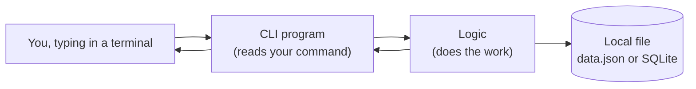
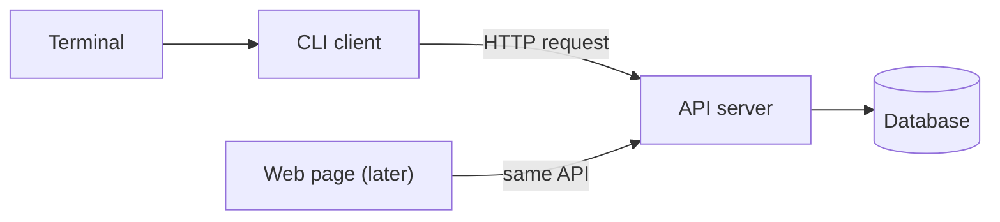

# ⌨️ CLI: The Terminal as Your Client

> Part of [Surfaces](./README.md): *same architecture, different client.*

## What it is

A **CLI** (command-line interface) is a program you use by **typing commands** in a terminal instead of clicking buttons. You've already used some: `git`, `gh`, `npm`.

It's like **texting your computer**: you type `log add "spent $12 on lunch"`, press Enter, and it texts back `Saved.`

## When to choose it

- ✅ Your problem happens **while you're at your computer**.
- ✅ You want the **fastest possible first version** (no screens to design).
- ✅ It's about **automating something repetitive**: renaming files, logging things, pulling data, generating reports.
- ✅ You want to **prove your logic works** before building a "real" front end.
- ❌ Skip it if you need it **on your phone**, or you need **visuals** (charts, images, maps) as the main experience.

> 💡 **A CLI is a great skateboard.** If your core feature works in a terminal, adding a web or mobile front end later is mostly new UI. The thinking is already done.

## Architecture

### Simplest: everything on your computer



**Follow one action:** you type `node log.js add "lunch $12"`
1. **Client:** the CLI reads your command and its arguments (`add`, `"lunch $12"`).
2. **Logic:** a function figures out what to do (create a new entry with today's date).
3. **Data:** it saves the entry to `data.json`.
4. **Back to you:** it prints `Saved.`

### Growing up: the same CLI talking to a server



When your data needs to live online (to share it, or use it from several devices), the CLI sends **requests** to an API, the same way a website does. Later, a web page can call **the same API**. That's the "same architecture" idea.

## Beginner-friendly stacks

| Level | Client | Logic | Data | Notes |
|---|---|---|---|---|
| **Simplest** | Python script (`sys.argv` or `argparse`) | Same file | JSON file | Great if you know Python from other classes |
| **Common** | Node.js script (`process.argv`) | Same file or a separate module | JSON file or SQLite | Same language as web (JavaScript/TypeScript) |
| **Stretch** | Python with **Typer**, or Node with **Commander** | Separate modules | SQLite or a hosted database (e.g. Supabase) | Nice help menus and subcommands |

## Words to use with your AI agent

`command-line arguments` · `subcommands` (like `add`, `list`, `delete`) · `flags` (like `--date`) · `standard output` · `exit code` · `read/write a JSON file` · `SQLite` · `environment variables` (`.env`) for any keys · `separate the CLI from the logic`

## How to demo it (for Product 1)

- 👍 **Screenshots** of commands and output in your terminal
- 👏 **A short screen recording or GIF** of you running 3–4 commands
- 🏆 **Make it installable**: clear "How to run" steps in your README (`git clone …`, `npm install`, `node log.js list`) that a classmate can follow on their own computer

## 🤖 Prompts

**Explain it:**
```text
Explain what a command-line interface (CLI) is and how it acts as the
"client" in a client → logic → data architecture. Use one everyday analogy.
Then explain how the same logic could later be used by a web app.
```

**Plan it from my spec:**
```text
Here's my product spec: [paste README or attach repo]. Ask me questions to
decide whether a CLI makes sense as my first version. If it does, propose the
smallest set of commands for my MVP (e.g. add, list) and a simple data file
format. Don't write code yet.
```

**Build it with me (I write the code):**
```text
I want to build a tiny CLI in [Node.js / Python] for this MVP feature:
[describe it]. Save data to a local JSON file. Break it into small steps and
explain each one. Let me write the code, then review what I wrote. Only show
code when I'm stuck and ask.
```

## Learn more
- [Command Line Interface Guidelines](https://clig.dev): how good CLIs behave
- [Python `argparse` tutorial](https://docs.python.org/3/howto/argparse.html)
- [Node.js: command-line arguments](https://nodejs.org/en/learn/command-line/nodejs-accept-arguments-from-the-command-line)
- Class: [Full-Stack Architecture & APIs (Sep 9)](https://app.read.ai/analytics/meetings/01M243JXD2A0R750CJ6DMCN2QP?utm_source=Share_CopyLink), where clients and servers apply to the command line too
