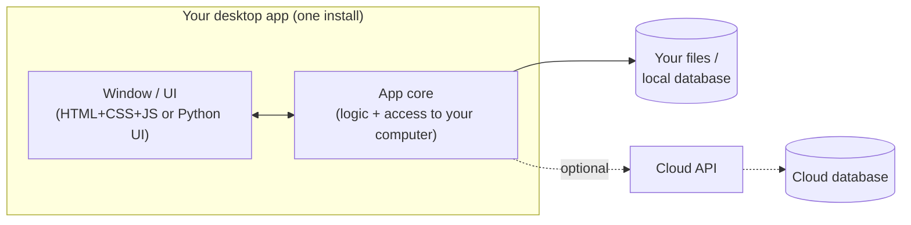

# 🖥️ Desktop: An App Window on Your Computer

> Part of [Surfaces](./README.md): *same architecture, different client.*

## What it is

A **desktop app** is a program you **install and open in its own window** on Mac, Windows or Linux, like Spotify, VS Code, Slack, Discord or the Claude and ChatGPT apps.

Many modern desktop apps are secretly **web apps in a wrapper**: they use HTML, CSS and JavaScript inside a window, plus extra powers a website doesn't get, like **reading your files, working fully offline, and living in your menu bar or dock**.

## When to choose it

- ✅ Your problem happens **at your computer**, and a browser tab feels wrong.
- ✅ You need to work with **files on your computer** (organize downloads, batch-edit photos, read local notes).
- ✅ It should work **offline**, or **run in the background** (a menu bar timer, a focus blocker).
- ✅ You want a **visual** version of something that would otherwise be a [CLI](./cli.md).
- ❌ You want people to open it from a link without installing anything? Choose [Web](./web.md).

## Architecture



**Follow one action:** you drag 40 messy screenshots onto a "Screenshot Sorter" app
1. **Window (UI):** it shows a drop zone. You drop the files, and the UI sends the file list to the core.
2. **App core:** it reads each file's date and renames and moves it into `Screenshots/2026-10/`.
3. **Local data:** it saves a log of what moved, so you can undo.
4. **Optional cloud:** later, it could sync your settings across computers through an API.

> Notice: **no server is needed** for a personal desktop app. The "kitchen" can live inside the app itself. Add a cloud API only when you need syncing or sharing.

## Beginner-friendly stacks

| Level | Tool | Language | Notes |
|---|---|---|---|
| **Simplest** | **Tkinter** or **PySide/Qt** | Python | Comes with Python (Tkinter). Great if you know Python. |
| **Common** ⭐ | **Electron** | JavaScript/TypeScript (+ React if you want) | Web skills → desktop app. Used by VS Code, Slack, Discord. |
| **Stretch** | **Tauri** | JavaScript UI + Rust core | Much smaller, faster apps. Rust is a learning curve, but AI helps. |

## Words to use with your AI agent

`Electron main process vs renderer process` · `IPC` (how the window talks to the core) · `Tauri command` · `file system access` · `local SQLite` · `menu bar / system tray app` · `package the app` / `build an installer` · `Tkinter window` · `PySide`

## How to demo it (for Product 1)

- 👍 **Screenshots** of the app window
- 👏 **A screen recording or GIF** of you using it
- 🏆 **A downloadable build**: package the app and attach it to a **GitHub Release** (on your repo page: **Releases → Draft a new release → attach the file**) so classmates can install it. Add clear "How to run from source" steps to your README too.

## 🤖 Prompts

**Explain it:**
```text
Explain how desktop apps like VS Code or Slack work under the hood (Electron:
main process, renderer, IPC) in plain language with an analogy. Compare that
with Tauri and with a simple Python Tkinter app.
```

**Decide if desktop fits my spec:**
```text
Here's my product spec: [paste README or attach repo]. Ask me questions to
decide whether a desktop app, a web app or a CLI is the best first version.
Consider whether I need local files, offline use or background running, and
what I already know. Recommend the simplest option for about 4 weeks. Don't
write code yet.
```

**Start it (I write the code):**
```text
I'm building a small desktop app with [Electron / Tauri / Python Tkinter] for
this MVP feature: [describe it]. Walk me through setting up the project and
showing a first window with one button that does [core action]. Explain each
file and command, and let me write the code.
```

## Learn more
- [Electron: Building your first app](https://www.electronjs.org/docs/latest/tutorial/tutorial-first-app)
- [Tauri: Get started](https://tauri.app/start/)
- [Python Tkinter docs](https://docs.python.org/3/library/tkinter.html)
- Class: [Full-Stack Architecture & APIs (Sep 9)](https://app.read.ai/analytics/meetings/01M243JXD2A0R750CJ6DMCN2QP?utm_source=Share_CopyLink), which covers desktop and other client surfaces
