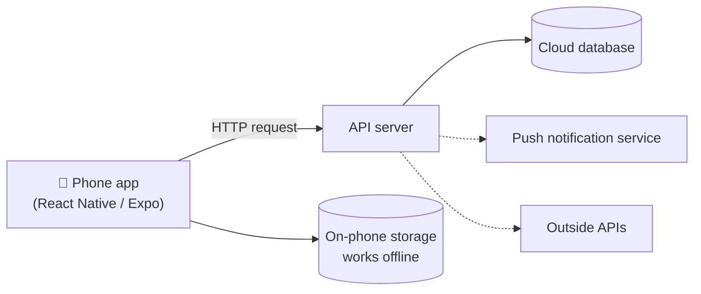

# 📱 Mobile & Cross-Platform: The Phone as Your Client

> Part of [Surfaces](./README.md): *same architecture, different client.*

## What it is

A **mobile app** runs on a **phone** (iPhone or Android) and can use phone superpowers: **notifications, the camera, location, offline use, and being one tap away on your home screen.**

**Cross-platform** means writing your app **once** and running it on **both iPhone and Android** (and sometimes the web too) instead of building two separate apps.

> On Sep 9 we traced an **Instagram post**: the app packages your photo, caption and tags, sends them to a server, through a load balancer, and into a database. The phone is just the **client**. The kitchen behind it is the same kind you'd build for a website.

## When to choose it

- ✅ Your problem happens **on the go**, away from a computer.
- ✅ You need **notifications**, the **camera**, **location**, or **offline** use.
- ✅ It's something you'd check **many times a day**, like a habit tracker, a gym log or a quick capture.
- ❌ Skip it if a **phone-friendly website** would do. A web app works in your phone's browser with much less setup (see the PWA option below).

## Three ways to build for phones

| Approach | What it means | Tools | Good for |
|---|---|---|---|
| **Cross-platform** ⭐ | One codebase → iPhone + Android | **React Native with Expo** (JavaScript/TypeScript), **Flutter** (Dart) | Most student projects. Expo is the friendliest start. |
| **Native** | A separate app per platform, in its own language | **Swift** (iPhone), **Kotlin** (Android) | Deep phone features, max performance. Swift needs a Mac. |
| **Phone-friendly web app (PWA)** | A website that can be "installed" to your home screen | Next.js or any web stack | The cheapest path, and it shares everything with [Web](./web.md) |

## Architecture



**Follow one action:** you log a workout at the gym
1. **Phone app:** you tap **+ Set**, enter 135 lbs × 8, and tap **Save**.
2. **On-phone storage:** it saves instantly on your phone, so it still works with bad gym Wi-Fi.
3. **API:** when you're back online, the app sends the set to your server.
4. **Database:** the server stores it so your history is safe even if you lose your phone.
5. **Notification (optional):** the server reminds you on Thursday: *"Last time: 135 × 8. Try 140?"*

> 💡 **Start simple:** for a personal MVP, on-phone storage alone (no server at all) is a completely valid skateboard. Add a server when you need sync, backup or sharing.

## Beginner-friendly stacks

| Level | Client | Back end | Data |
|---|---|---|---|
| **Simplest** | **Expo** (React Native) | none | On-phone storage (AsyncStorage / SQLite) |
| **Common** ⭐ | **Expo** + Expo Router | **Supabase** (database + login, no server code to write) | Supabase (PostgreSQL) |
| **Alt** | **Flutter** | Firebase or Supabase | Firestore / PostgreSQL |
| **Shortcut** | **PWA**: a Next.js site added to your home screen | Next.js API routes | Supabase |

## Words to use with your AI agent

`Expo` · `React Native` · `Expo Go` · `Expo Router` · `screen` · `component` · `AsyncStorage` / `expo-sqlite` · `offline-first` · `push notifications` (`expo-notifications`) · `camera` (`expo-camera`) · `Supabase client` · `cross-platform` · `PWA` (progressive web app)

## How to demo it (for Product 1)

- 👍 **Screenshots** from your phone or a simulator
- 👏 **A screen recording** from your phone. iPhone and Android both have a built-in screen recorder in their quick settings.
- 🏆 **Live on a phone:** with Expo, classmates can install the free **Expo Go** app and scan your project's QR code to open it. For a PWA, share the URL.

## 🤖 Prompts

**Explain it:**
```text
Explain the difference between native, cross-platform (React Native/Expo,
Flutter) and a progressive web app, in plain language with one analogy. Then
show how a mobile app fits into a client → API → database architecture.
```

**Decide if mobile fits my spec:**
```text
Here's my product spec: [paste README or attach repo]. Ask me questions about
where and when I experience this problem, then help me decide between a
mobile app (Expo), a phone-friendly web app, or something else. Give the
trade-offs for a student with about 4 weeks. Don't write code yet.
```

**Start with Expo (I write the code):**
```text
I'm building my MVP with Expo (React Native). My first screen should let me
[describe the core action] and save it on the phone so it works offline.
Walk me through creating the project and running it on my phone with Expo Go,
step by step, explaining each command. Let me write the code myself.
```

## Learn more
- [Expo tutorial](https://docs.expo.dev/tutorial/introduction/): build your first app step by step
- [React Native docs](https://reactnative.dev/docs/getting-started)
- [Flutter: Get started](https://docs.flutter.dev/get-started)
- [web.dev: Progressive Web Apps](https://web.dev/explore/progressive-web-apps)
- Class: [Full-Stack Architecture & APIs (Sep 9)](https://app.read.ai/analytics/meetings/01M243JXD2A0R750CJ6DMCN2QP?utm_source=Share_CopyLink), which covers phones as clients and the Instagram request flow
