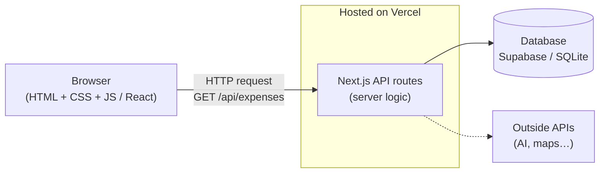

# 🌐 Web: The Browser as Your Client

> Part of [Surfaces](./README.md): *same architecture, different client.*
> 🎥 Class recording: [Web Application Foundations (Oct 5)](https://app.read.ai/analytics/meetings/01M471XZK43DDGWS9ATCT0RFS6?utm_source=Share_CopyLink)

## What it is

A **web app** is a product people use **in a browser** (Chrome, Safari, Edge) by visiting a **URL**. It works on laptops *and* phones, with nothing to install.

> *"All a server does is listen for requests and send back data in a response."*

When you open a website, your browser (the **client**) asks a **server**: *"Hey, can I get this page?"* And the server says: *"Yeah, I got you,"* and sends back files your browser knows how to show.

## When to choose it

- ✅ You want to use it on **any device** with a browser, laptop or phone.
- ✅ You want something people can open from **a link**.
- ✅ Your product is mostly **forms, lists, dashboards or content**.
- ✅ You want the stack most AI agents know best (**Next.js**).
- ❌ You need deep phone features (background notifications, the camera all the time, working fully offline)? Look at [Mobile](./mobile-cross-platform.md).

## The pieces (from class)

### A URL has three main parts
`https://github.com/464squad/IEL`
- **Protocol** `https://`: the rules for the conversation (secure HTTP)
- **Domain** `github.com`: a human-readable name for *a computer somewhere*. **DNS** is the phone book that turns it into an IP address.
- **Path** `/464squad/IEL`: *which* thing on that computer you want

### The front end: three languages the browser speaks
| Language | Job | Think of it as… |
|---|---|---|
| **HTML** | Structure: headings, buttons, lists | The **skeleton** 🦴 |
| **CSS** | Style: colors, sizes, layout | Making it **look nice** 🎨 |
| **JavaScript** | Behavior: reacting to clicks and typing | Making it **interactive** ⚡ |

> *"The web uses those three… that's the surface. But the back end part, you can be flexible."*

- **React** lets you build pages out of reusable **components**: a `VideoCard` you can repeat 20 times, like YouTube does.
- **Next.js** is a framework for React that puts **your front end and your back end in one project**. It's what most AI agents reach for today, usually with **TypeScript** (JavaScript with better error checking).

### The back end: the kitchen
A server listens for requests on **routes** (like `/api/expenses`) and responds with data. It can be written in JavaScript, Python, Java and more. That part is your choice. **DevTools → Network** (right-click → **Inspect** → **Network**) shows every request a page makes. Try it on any site.

### Data and hosting
- **Database:** where your data lives between visits (for example **Supabase**, which is hosted PostgreSQL, or SQLite to start).
- **Hosting:** a computer on the internet that runs your app so others can reach it (for example **Vercel** for Next.js).

## Architecture



**Follow one action:** you click **Save** on a new expense
1. **Browser:** JavaScript grabs what you typed and sends a **POST** request to `/api/expenses`.
2. **API route:** the server checks the data and saves it.
3. **Database:** it stores the new row.
4. **Response:** the server replies `201 Created`, and the page updates your list.

## Beginner-friendly stacks

| Level | Front end | Back end | Data | Hosting |
|---|---|---|---|---|
| **Simplest** | Plain HTML/CSS/JS | none (data saved in the browser with `localStorage`) | Browser storage | **GitHub Pages** (free) |
| **Common** ⭐ | **Next.js** (React + TypeScript) | Next.js API routes | **Supabase** or SQLite | **Vercel** (free tier) |
| **Stretch** | React (Vite) | **Express** (Node) or **FastAPI** (Python) | PostgreSQL | Vercel + Render |

## Words to use with your AI agent

`Next.js App Router` · `TypeScript` · `React component` · `API route` · `GET / POST / PUT / DELETE` · `fetch` · `JSON` · `form` · `state` · `Supabase table` · `environment variables` (`.env.local`) · `deploy to Vercel` · `responsive` (works on phone screens)

## How to demo it (for Product 1)

> ⚠️ **The localhost meme.** Sending someone `http://localhost:3000` is like giving them directions to a room in *your* house. **Localhost means "this computer."** It only works on your machine. To share it, you need a server on the internet: that's **deploying**.

- 👍 **Screenshots** of each main screen
- 👏 **A short screen recording or GIF** of you using it
- 🏆 **A live URL**. For a Next.js app, the usual path is:
  1. Push your code to GitHub.
  2. Sign in at [vercel.com](https://vercel.com) with GitHub → **Add New… → Project** → pick your repo → **Deploy**.
  3. Add any secrets (like database keys) under **Settings → Environment Variables**, not in your code.
  4. Each time you push, Vercel builds a new version, and **pull requests get their own preview links**.
  5. Put the link at the top of your README.

## 🤖 Prompts

**Explain it:**
```text
Explain how a web app works using a restaurant analogy: browser, URL, DNS,
server, API route, database and hosting. Then follow what happens when I
click "Save" on a form, step by step.
```

**Plan it from my spec:**
```text
Here's my product spec: [paste README or attach repo]. I want to build my MVP
as a web app with Next.js. Propose the pages, the API routes and the data
tables I need, the smallest possible version. Ask me questions before
assuming anything. Don't write code yet.
```

**Deploy it:**
```text
My Next.js app works on localhost. Walk me through deploying it to Vercel
from my GitHub repo, step by step, including where to put environment
variables so no secrets end up in my code. Explain what each step does.
```

## Learn more
- [Next.js Learn](https://nextjs.org/learn) (free course). Finishing it gives you a real app you could adapt for your project.
- [React: Quick Start](https://react.dev/learn) and [Tic-Tac-Toe tutorial](https://react.dev/learn/tutorial-tic-tac-toe)
- [MDN: How the web works](https://developer.mozilla.org/en-US/docs/Learn_web_development/Getting_started/Web_standards/How_the_web_works)
- [Vercel: Deploying from Git](https://vercel.com/docs/deployments/git) · [Supabase docs](https://supabase.com/docs)
- Class: [Web Application Foundations (Oct 5)](https://app.read.ai/analytics/meetings/01M471XZK43DDGWS9ATCT0RFS6?utm_source=Share_CopyLink) · [Full-Stack Architecture & APIs (Sep 9)](https://app.read.ai/analytics/meetings/01M243JXD2A0R750CJ6DMCN2QP?utm_source=Share_CopyLink)
